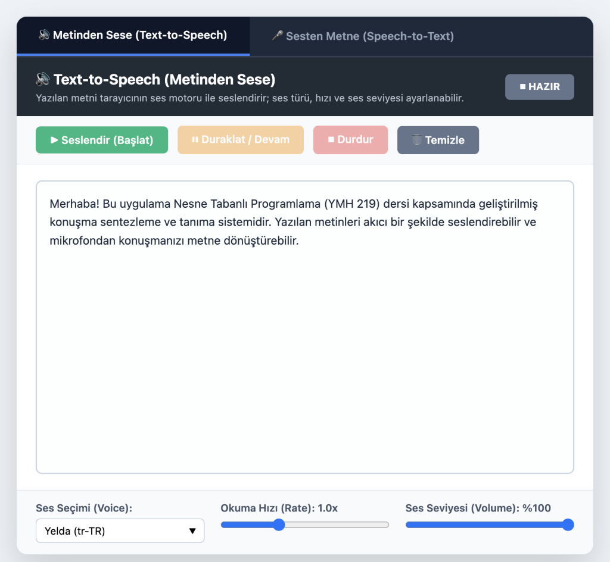

# YMH219 - SpeechApp: Ses ve Metin Dönüşüm Uygulaması

<div align="center">


**🔊 TTS + 🎤 STT | Web Speech API Canlı Demo**

[🌐 Canlı Demo](https://meryemmelek41-mm.github.io/YMH219-SpeechApp/) | [📁 Repo](https://github.com/meryemmelek41-mm/YMH219-SpeechApp)

</div>

---

## 👩‍💻 Öğrenci Bilgileri

| Alan | Bilgi |
|------|-------|
| **Ad Soyad** | Meryem Melek Şimşek |
| **Öğrenci No** | 250541017 |
| **Ders** | YMH219 - Nesne Tabanlı Programlama |
| **Ödev No** | 4 |
| **Teslim Tarihi** | 30 Kasım 2026 |

---

## 📌 Proje Açıklaması

Bu uygulama **metinden sese (TTS)** ve **sesten metne (STT)** dönüşüm özelliklerini C# Windows Forms üzerinde gerçekleştirmektedir. `System.Speech` kütüphanesi kullanılarak:

- 🔊 **TTS (Text-to-Speech):** Girilen metni seçilen sesle okur, hız/ses seviyesi ayarlanabilir
- 🎤 **STT (Speech-to-Text):** Mikrofon girişini gerçek zamanlı olarak metne dönüştürür
- 📊 Tanıma geçmişi zaman damgası ve güven skoru ile listelenir
- 💾 Tanıma geçmişi `.txt` dosyasına kaydedilebilir

---

## 🖼️ Ekran Görüntüleri

### TTS Paneli (Metin → Ses)


### STT Paneli (Ses → Metin)


---

## 🏗️ OOP Sınıf Yapısı

| Sınıf | Tür | Sorumluluk | OOP İlkeleri |
|-------|-----|------------|--------------|
| `RecognitionHistoryModel` | Model | STT sonuçlarını depolar (metin, güven, zaman) | Encapsulation, Properties |
| `SpeechSynthesisService` | Service | TTS işlemlerini yönetir (Seslendir/Durdur/Duraklat) | Encapsulation, Event, Dispose |
| `SpeechRecognitionService` | Service | STT motorunu yönetir (Başla/Durdur, olaylar) | Encapsulation, Event, Dispose |
| `FormMain` | View | Kullanıcı arayüzü ve servis entegrasyonu | Composition, Event Handler |

---

## 📦 NuGet Paketleri

| Paket | Versiyon | Açıklama |
|-------|----------|----------|
| `System.Speech` | 8.0.0 | Windows TTS ve STT motoru |

---

## 🚀 Çalıştırma Talimatları

### Gereksinimler
- **Windows 10/11** (System.Speech Windows'a özeldir)
- **Visual Studio 2022** veya üstü
- **.NET 6.0 SDK**

### Adımlar
```bash
# 1. Repoyu klonla
git clone https://github.com/meryemmelek41-mm/YMH219-SpeechApp.git
cd YMH219-SpeechApp

# 2. Visual Studio'da aç
start SpeechApp.sln

# 3. NuGet paketlerini geri yükle (otomatik)
# 4. F5 ile çalıştır (Windows gerekli)
```

### Web Demo (Tüm platformlar)
Web demosu **Google Chrome**'da en iyi çalışır (Web Speech API gerektirir):
👉 **https://meryemmelek41-mm.github.io/YMH219-SpeechApp/**

---

## ✨ Özellikler

| Özellik | TTS | STT |
|---------|-----|-----|
| Gerçek zamanlı işlem | ✅ | ✅ |
| Ses/hız kontrolü | ✅ | — |
| Güven skoru | — | ✅ |
| Geçmiş listeleme | — | ✅ |
| Dosyaya kaydet | — | ✅ |
| Çoklu ses seçimi | ✅ | — |
| Duraklat/Devam Et | ✅ | — |

---

## 📜 Lisans

Bu proje YMH219 dersi ödev amaçlı hazırlanmıştır.
