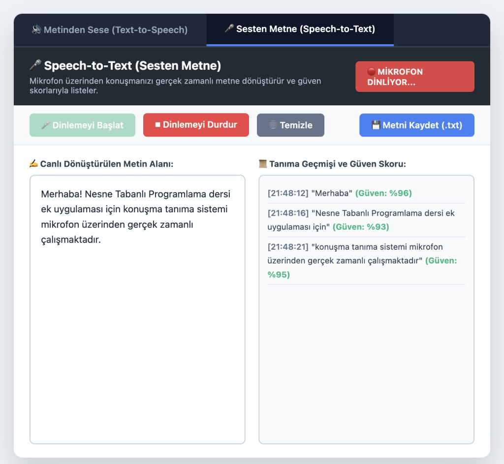

# 🎤 Speech-to-Text ve Text-to-Speech Uygulaması - YMH219

**Nesne Tabanlı Programlama (YMH 219)** dersi kapsamında geliştirilen, metin ve ses arasında çift yönlü dönüşüm (Text-to-Speech & Speech-to-Text) gerçekleştiren Windows Forms masaüstü uygulaması.

🎮 **Canlı Web Demosu (Tarayıcıda Hemen Deneyin):** [https://meryemmelek41-mm.github.io/YMH219-SpeechApp/](https://meryemmelek41-mm.github.io/YMH219-SpeechApp/)

---

## 📋 Proje Hakkında

Bu uygulama, ses ve metin verilerini çift yönlü olarak işleyen kapsamlı bir masaüstü yazılımıdır:
1. **Text-to-Speech (TTS):** Kullanıcının yazdığı veya yapıştırdığı metinleri `System.Speech.Synthesis` motoru ile sesli olarak okur; ses hızı, seviyesi ve sistem sesleri arasında geçiş imkanı tanır.
2. **Speech-to-Text (STT):** `System.Speech.Recognition` altyapısı ve `DictationGrammar` kullanarak mikrofon üzerinden konuşmayı yakalar, gerçek zamanlı olarak metne dönüştürür ve güven skorlarıyla listeler.

---

## 🛠️ Kullanılan Teknolojiler

- **C# / .NET 6.0 (Windows Forms)** - Temel programlama dili ve kullanıcı arayüzü
- **System.Speech (NuGet / .NET Runtime)**:
  - `SpeechSynthesizer`: Metin sentezleme, duraklatma ve ses parametreleri
  - `SpeechRecognitionEngine`: Konuşma tanıma, ses giriş cihazı kontrolü
  - `DictationGrammar`: Serbest konuşma grameri
- **System.IO (StreamWriter)**: Konuşma metnini ve güven skorlu geçmişi yerel `.txt` dosyasına aktarma
- **Visual Studio 2022** - Geliştirme ortamı
- **Web Speech API (`speechSynthesis` & `webkitSpeechRecognition`)** - Canlı web simülasyonu

---

## 🚀 Kurulum ve Çalıştırma

### 1. Windows Forms (C# / .NET) Masaüstü Uygulaması
1. Projeyi bilgisayarınıza klonlayın:
   ```bash
   git clone https://github.com/meryemmelek41-mm/YMH219-SpeechApp.git
   ```
2. `SpeechApp.sln` çözüm dosyasını **Visual Studio 2022** ile açın.
3. Projeyi derleyin ve **F5** tuşuna basarak çalıştırın.

**Gereksinimler:**
- Windows 10/11
- Visual Studio 2022
- .NET 6.0 SDK (Windows Forms desteği ile)
- Çalışan bir ses çıkış aygıtı (hoparlör/kulaklık) ve ses giriş aygıtı (mikrofon)

### 2. Canlı Web Demosu
Windows ortamı olmayan veya sistemi hemen tarayıcıda test etmek isteyenler için:
- [Canlı Web Demosu](https://meryemmelek41-mm.github.io/YMH219-SpeechApp/) bağlantısını açarak doğrudan bilgisayarınızın hoparlöründen ses sentezleyebilir ve mikrofonunuzla konuşup metne dönüştürebilirsiniz.

---

## 🎮 Uygulamanın Temel Özellikleri

### 🔊 Text-to-Speech (Metinden Sese)
- **Metin Seslendirme:** Geniş metin kutusuna girilen tüm cümleleri akıcı şekilde seslendirir.
- **Oynatma Kontrolleri:** "▶ Seslendir (Başlat)", "⏸ Duraklat / Devam Et", "⏹ Durdur" ve "🗑 Temizle" butonları.
- **Açık Durum Bildirimi:** Üst panelde durum anlık olarak gösterilir (🟢 `SESLENDİRİLİYOR...` / 🟡 `DURAKLATILDI` / ⏹ `HAZIR`).

### 🎤 Speech-to-Text (Sesten Metne)
- **Canlı Konuşma Tanıma:** "🎤 Dinlemeyi Başlat" butonuna basıldığında mikrofon dinlemeye geçer ve konuşulan sözcükler metin kutusuna yazılır.
- **Mikrofon Durum Rozeti:** Dinleme sırasında 🔴 `MİKROFON DİNLİYOR...` şeklinde belirgin görsel animasyon gösterilir.
- **Hata Kontrolü:** Mikrofon bulunamadığında veya konuşma servisine erişilemediğinde uygulamanın çökmesi engellenir ve kullanıcıya anlaşılır Türkçe hata uyarısı verilir.

### 🌟 İsteğe Bağlı Geliştirmeler (Bonus Özellikler)
- **Ses Ayarları (Voice, Rate, Volume):**
  - Sistemde yüklü olan ses profilleri (`InstalledVoices`) arasından seçim yapılabilir.
  - Okuma hızı slider ile `-10` ile `+10` arasında dinamik ayarlanabilir.
  - Ses seviyesi slider ile `%0` ile `%100` arasında kontrol edilebilir.
- **Zaman Damgalı Tanıma Geçmişi & Güven Skoru:** Her algılanan konuşma parçası zaman damgası ve yüzde bazında doğruluk güven skoruyla listelenir (Örn: `[21:48:12] "Merhaba" (Güven: %96)`).
- **Dönüştürülen Metni Dosyaya Kaydetme:** "💾 Metni Kaydet (.txt)" butonu ile tam metin ve zaman damgalı güven skoru geçmişi biçimlendirilmiş bir rapor olarak `.txt` dosyasına aktarılır.

---

## 🏗️ Proje Yapısı

```
YMH219-SpeechApp/
├── SpeechApp.sln                   # Visual Studio Çözüm Dosyası
├── .gitignore                      # Derleme dosyalarını dışlama kuralları
├── README.md                       # Proje dokümantasyonu
├── docs/                           # GitHub Pages canlı web demo dosyaları
│   └── index.html
├── preview/                        # Yerel web önizleme dosyası
│   └── index.html
└── SpeechApp/
    ├── SpeechApp.csproj            # .NET 6.0 WinForms proje dosyası (System.Speech referanslı)
    ├── Program.cs                  # Uygulama giriş noktası
    ├── FormMain.cs                 # Ana form (TTS & STT kontrolleri ve olay yönetimi)
    ├── FormMain.Designer.cs        # Form arayüz tasarım kodu
    ├── RecognitionHistoryModel.cs  # Tanıma geçmişi ve güven skoru veri modeli (OOP)
    ├── SpeechSynthesisService.cs   # Text-to-Speech motoru ve ses parametreleri servisi (OOP)
    ├── SpeechRecognitionService.cs # Speech-to-Text motoru ve mikrofon servisi (OOP)
    └── screenshots/
        ├── tts_section.png         # Metinden Sese arayüzü ekran görüntüsü
        └── stt_section.png         # Sesten Metne ve güven skoru ekran görüntüsü
```

---

## 📸 Ekran Görüntüleri

### 1. Text-to-Speech (Seslendirme, Hız ve Ses Ayarları)


### 2. Speech-to-Text (Mikrofon Dinleme, Canlı Metin ve Güven Skorları)


---

## ⚙️ Nesne Tabanlı Tasarım (OOP)

| Sınıf | Sorumluluk |
|---|---|
| `RecognitionHistoryModel` | Her bir konuşma tanıma sonucunun zamanını, tanınan metnini ve float güven skorunu kapsüller; formatlı string üretir. |
| `SpeechSynthesisService` | `SpeechSynthesizer` nesnesini yönetir; `Rate`, `Volume`, ses seçimi, asenkron konuşma (`SpeakAsync`), duraklatma ve kaynak temizleme (`IDisposable`) işlemlerini üstlenir. |
| `SpeechRecognitionService` | `SpeechRecognitionEngine` ve `DictationGrammar` ile mikrofon girişini dinler; tanıma olaylarını tetikler ve donanım/erişim hatalarını yönetir. |
| `FormMain` | Kullanıcı arayüzünü (sekmeler, slider'lar, durum göstergeleri, metin alanları) yönetir; servislerden gelen olayları thread-safe şekilde UI'a yansıtır. |

---

## ⚠️ Bilinen Sınırlamalar

- Masaüstü sürümünde Türkçe konuşma tanıma yapılabilmesi için Windows Ayarları -> Zaman ve Dil -> Konuşma menüsünden Türkçe konuşma tanıma paketinin indirilmiş olması önerilir.
- Web sürümünde mikrofon kullanımı için tarayıcının mikrofon izni vermesi gerekmektedir.

---

## 👤 Öğrenci Bilgileri

- **Adı Soyadı:** Meryem Melek Şimşek  
- **Öğrenci No:** 250541017  
- **Ders:** Nesne Tabanlı Programlama (YMH 219)  
- **Ödev No:** 4 (Speech-to-Text ve Text-to-Speech Uygulaması)
